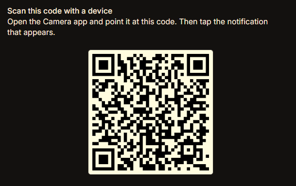
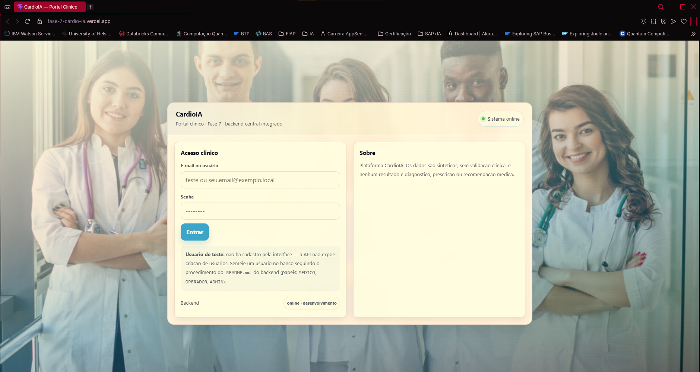
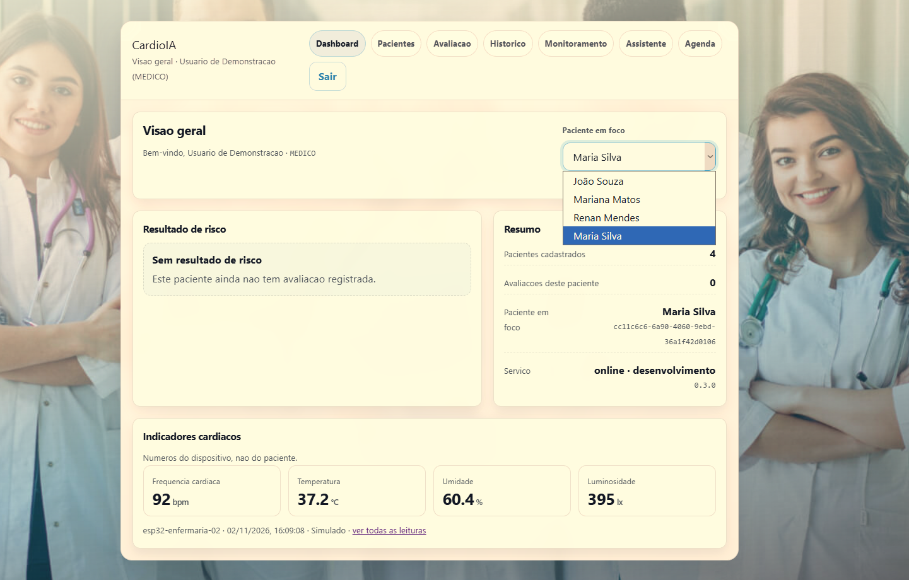
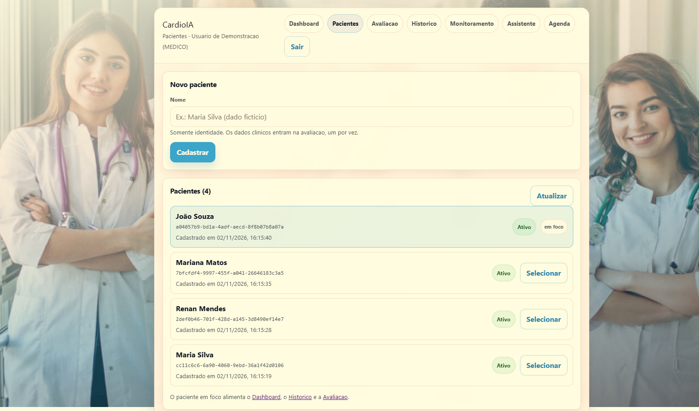
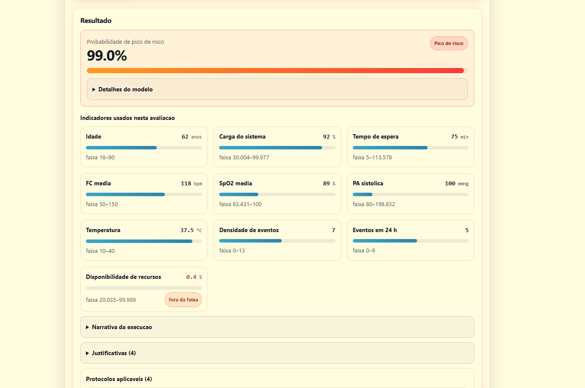
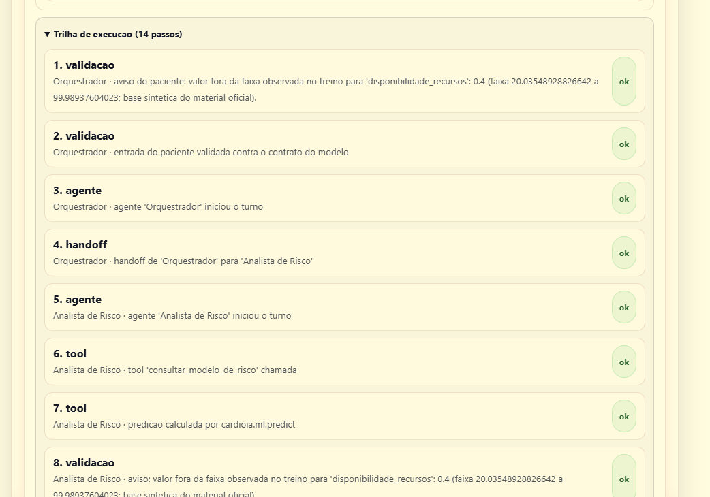
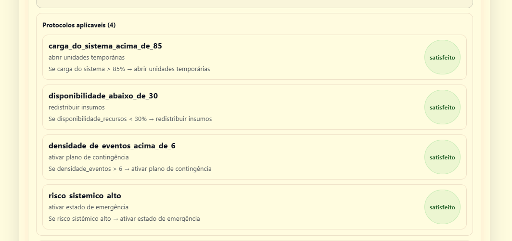
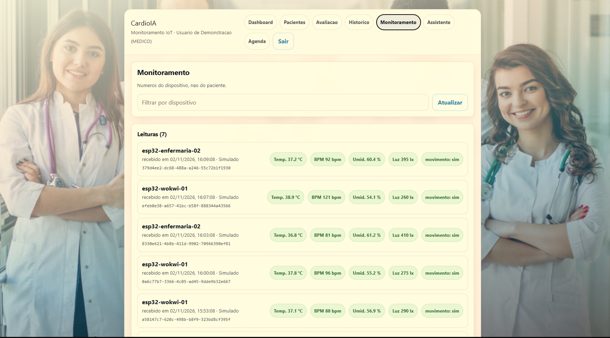
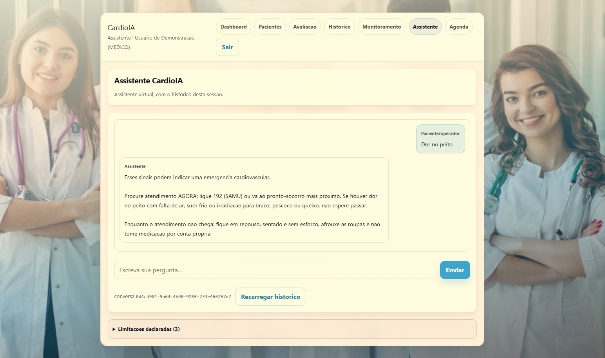

# CardioIA — Fase 7

<p align="center">
  <a href="https://www.fiap.com.br/"></a>
</p>

<p align="center">
  <strong>CardioIA</strong><br>
</p>

Fase final e solução funcional do **CardioIA**: Construimos um ecossistema que vai do sinal captado
até a recomendação exibida na interface, juntando todos os módulos
desenvolvidos nas fases anteriores sob uma única interface e solução.

> *Os dados do projeto são **sintéticos**.
---

## Autor

| Nome | RM |
|---|---|
| [Renan de Oliveira Mendes](https://www.linkedin.com/in/renanmendes26/) | RM563145 |

## Vídeo

- **Fase 7:** https://youtu.be/v-__IQXEDMA
- **App:** 
---

## Links da entrega

| Item | Endereço |
|---|---|
| **Aplicação Web (Vercel)** | https://fase-7-cardio-ia.vercel.app |
| **Backend (Render)** | https://cardioia-backend-z8pz.onrender.com |
| **APK (Expo / EAS)** | https://expo.dev/accounts/remendess/projects/cardioia/builds/b3492405-08d4-4a15-a4dd-a29b9f5010ec|
| **Relatório técnico (HTML e PDF)** | docs/RELATORIO_FASE7.html |


## QR Code para Download do App - Android


### Conta de demonstração

| Campo | Valor |
|---|---|
| E-mail | `teste` |
| Senha | `senhaTeste23@` |
| Papel | `MEDICO` |

---

## 1. Solução

A solução funciona com um backend rodando hospedado no Render e o Frontend na Vercel.
Utilizando tudo desenvolvido das outras fases o CardioAI tem de inicio uma tela de login, com autenticação




Após acessar, a primeira página é o Dashboard, que mostra cards e resumos estruturados por pacientes.
Mostrando informações de risco, avaliações e indicadores cardiacos.




Na aba Pacientes podemos cadastrar pacientes e salvar no banco de dados.



A página de avaliação é a mais extensa e é onde estão:

- Ficha do paciente
- Modelo de classificação treinado operando em cima dos dados do paciente
- Agentes de análise de risco e de acionamento de protocolos









Na página de Monitoramento são mostrados os dados dos sensores - Wokwi



A página de Assistente é o agente conversacional por IA, que opera em cima da abordagem de RAG dos dados do paciente e com guardrails de segurança.



## 2. Arquitetura final

```
  ┌──────────────────┐
  │  SENSOR          │  DHT22 (temperatura) + botão (BPM simulado)
  │  ESP32 / Wokwi   │
  └────────┬─────────┘
           │
  ┌────────▼─────────┐
  │  MICROPYTHON     │  avalia os sinais NA BORDA  ->  OLED + LED
  │  IoT/main.py     │  (38 °C / 120 bpm, os mesmos limiares do backend)
  └────────┬─────────┘
           │  HTTP POST  /api/v1/iot/leituras   (X-Device-Key)
  ┌────────▼─────────────────────────────────────────┐
  │  BACKEND PYTHON  (FastAPI)                       │
  │  ┌────────────┬────────────┬────────────┐        │
  │  │ Fase 3     │ Fase 4     │ Fase 5     │ Fase 6 │
  │  │ regras IoT │ visão      │ assistente │ risco  │
  │  └────────────┴────────────┴────────────┴────────┘
  │  auth JWT · RBAC · SQLite · auditoria · envelope │
  └────────┬──────────────────────────────┬──────────┘
           │  JSON (RespostaAPI[T])       │
  ┌────────▼─────────┐          ┌─────────▼──────────┐
  │  UI WEB          │          │  UI MOBILE         │
  │  React + Vite    │          │  React Native/Expo │
  │  (Vercel)        │          │  (APK via EAS)     │
  └──────────────────┘          └────────────────────┘
```

| Camada | Tecnologia | Onde |
|---|---|---|
| Sensor | ESP32 simulado no Wokwi (DHT22 + botão) | `IoT/` |
| Borda | **MicroPython** — avalia e sinaliza localmente | `IoT/main.py` |
| Integrador | **Python / FastAPI** — orquestra todos os módulos | `backend/` |
| IA | Fase 6 (modelo de risco) · Fase 5 (assistente) · Fase 4 (visão) | `backend/app/integracao/` |
| UI Web | React + Vite | `frontend/` |
| UI Mobile | React Native + Expo | `mobile/` |

---


## 3. Como executar localmente

### 3.1 Backend

```powershell
cd backend
python -m pip install -r requirements.txt
python -m app.dados.esquema          # cria o esquema

$env:JWT_SECRET = python -c "import secrets; print(secrets.token_urlsafe(48))"
python -m uvicorn app.main:app --reload --port 8000
```

A **conta de demonstração é criada automaticamente** no primeiro boot. Verificação:

```powershell
Invoke-RestMethod http://127.0.0.1:8000/api/v1/health
```

Documentação interativa da API: `http://127.0.0.1:8000/docs`

### 3.2 Frontend web

```powershell
cd frontend
npm install
npm run dev            # http://localhost:5173
```

### 3.3 App mobile

```powershell
cd mobile
npm install
npx expo start
```

### 3.4 Wokwi

Abra o projeto no Wokwi e substitua `main.py` e `diagram.json` pelos arquivos de `IoT/`.
Instruções completas em [`IoT/README.md`](IoT/README.md).

---

## 4. Estrutura do repositório

```text
Fase_7/
├── backend/     FastAPI — o integrador em Python (636 testes)
├── frontend/    React + Vite — aplicação web            → Vercel
├── mobile/      React Native + Expo — aplicativo        → APK (EAS)
├── IoT/         MicroPython + circuito Wokwi            → link público
├── docs/        Relatório técnico (imprimir em PDF)
├── Fase_1…6/    módulos das fases anteriores (sanitizados)
├── render.yaml  blueprint do backend no Render
├── DEPLOY.md    guia de publicação, passo a passo
├── CONTRATOS_API.md · MODELO_DADOS.md · DECISOES_ARQUITETURAIS.md
├── PLANO_SEGURANCA.md · ANALISE_ARQUITETURA.md · PROGRESSO_FASE7.md
└── README.md
```

---

## 5. Entregáveis 

| # | Requisito | Estado |
|---|---|---|
| 1 | Web publicada na Vercel, com CI/CD | Completo|
| 2 | `vercel.json` com rotas SPA | Completo |
| 3 | `app.json` com `android.package` em domínio invertido | Completo |
| 4 | `eas.json` com perfil `preview` | Completo |
| 5 | `.apk` funcional | Completo |
| 6 | Repositório privado compartilhado com o tutor | Completo |
| 7 | Pasta `Backend/` com os scripts Python de integração | Completo |
| 8 | Pasta `IoT/` com o script `.py` MicroPython | Completo |
| 9 | Projeto Wokwi público em MicroPython com LED/OLED | Completo |
| 10 | `README.md` com URL, QR do APK, prints e instruções | Completo |
| 11 | Relatório técnico PDF (≤ 5 páginas) com o diagrama | Completo |
| 12 | Refino de UX dos indicadores de risco | Completo |
| 13 | Validação do login e dos dados cardíacos | Completo |

---

## 7. Validação

| Verificação | Comando | Resultado |
|---|---|---|
| Suíte do backend | `cd backend && python -m pytest` | **636 testes** |
| Lint do frontend | `cd frontend && npm run lint` | 0 erros, 0 avisos |
| Build do frontend | `cd frontend && npm run build` | 46 módulos |
| Smoke da integração | `cd frontend && npm run smoke` | 65 verificações (3 papéis) |
| Bundle do app | `cd mobile && npx expo export --platform web` | 219 módulos, 413 KB |
| Sintaxe do firmware | `python -c "import ast; ast.parse(open('IoT/main.py').read())"` | OK |

---

## 8. Documentação

| Documento | Conteúdo |
|---|---|
| [`DEPLOY.md`](DEPLOY.md) | publicação no Render, Vercel e EAS + checklist |
| [`docs/RELATORIO_FASE7.html`](docs/RELATORIO_FASE7.html) | relatório técnico (imprimir em PDF) |
| [`IoT/README.md`](IoT/README.md) | o firmware e o circuito em detalhe |

